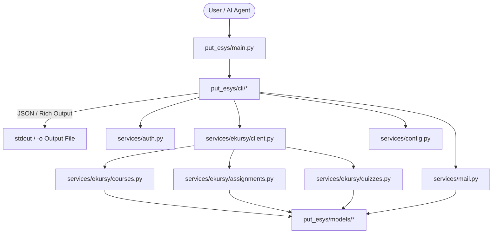

# Architecture & System Design - put-esys-cli

This document describes the internal architecture, layer separation, data models, and request flows of `put-esys-cli`.

---

## 🏛️ Layered Architecture

`put-esys-cli` follows a 4-tier modular architecture separating CLI commands from domain logic, data models, and low-level protocol integrations:

```
[ CLI Presentation Layer ]  -->  put_esys/cli/ (Typer sub-apps, Rich formatting, output flags)
         │
         ▼
[ Domain Services Layer ]   -->  put_esys/services/ (Auth, Config, Mail, eKursy modules)
         │
         ▼
[ Data Contract Layer ]     -->  put_esys/models/ (Pydantic v2 schemas: Course, Assignment, Quiz, Mail)
         │
         ▼
[ Network & Utils Layer ]   -->  Requests, BeautifulSoup4, IMAP/SMTP, Markdownify
```



---

## 📦 Module Breakdown

### 1. Presentation Layer (`put_esys/cli/`)
- `__init__.py`: Primary Typer app instance, sets up sub-commands and top-level commands (`login`, `save`, `download`).
- `course.py`: Commands for listing courses, searching, and viewing course hierarchy.
- `assignment.py`: Commands for inspecting assignments, uploading files, modifying submissions, and final submission.
- `quiz.py`: Commands for inspecting quizzes, dumping attempts to Markdown templates, syncing edited answers, and submitting.
- `mail.py`: Commands for mailbox listing, search, reading emails, downloading attachments, and sending.
- `config.py`: Management of PUT user credentials in local config storage.
- `display.py`: Rich layout formatters (tables, trees, panels) for human-readable terminal output.
- `helpers.py`: Decorators for error catching (`@catch_errors`) and session authentication verification (`check_authenticated`).

### 2. Services Layer (`put_esys/services/`)
- `auth.py`: Multi-step SSO authentication handling with `elogin.put.poznan.pl`, CSRF parsing, and automatic POST redirects.
- `config.py`: Secure storage and retrieval of credentials and session cookies via `appdirs`.
- `mail.py`: IMAP4_SSL and SMTP_SSL client for reading and sending university student mail.
- `ekursy/client.py`: Base client managing the authenticated `requests.Session` and landing page redirects.
- `ekursy/courses.py`: Scrapes course enrollment lists and course sections/activities.
- `ekursy/assignments.py`: Scrapes assignment details, handles Moodle draft file uploads, and manages submission states.
- `ekursy/quizzes.py`: Manages quiz attempts, questions, question types (multichoice, essay), and offline Markdown synchronization.
- `ekursy/draft_files.py`: Moodle file picker interaction and draft item ID generation.

### 3. Models Layer (`put_esys/models/`)
- `course.py`: `Course`, `Section`, `Activity` models.
- `assignment.py`: `Assignment`, `AssignmentSubmission`, `SubmissionFile` models.
- `quiz.py`: `QuizInfo`, `QuizAttempt`, `QuizQuestion`, `QuestionOption` models.
- `mail.py`: `MailMessage`, `MailFolder`, `MailAttachment` models.

---

## 🪟 Windows UTF-8 Terminal Handling

On Windows systems, Python's default console encoding may fall back to legacy codepages (e.g. `cp1250` or `cp1252`), leading to `UnicodeEncodeError` when rendering Polish diacritics or emojis.

`put_esys/main.py` explicitly handles this at boot:
```python
if sys.platform.startswith("win"):
    try:
        sys.stdout.reconfigure(encoding="utf-8")
        sys.stderr.reconfigure(encoding="utf-8")
    except Exception:
        pass
```
Additionally, all commands providing file export must bypass PowerShell's UTF-16 stream redirection by writing directly using `-o` / `--output` with explicit UTF-8 encoding.
