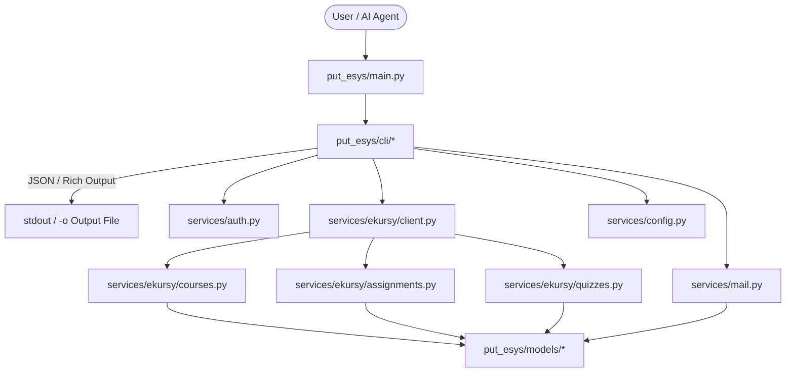

# Architecture & System Design - put-esys-cli

This document describes the internal architecture, layer separation, data models, and request flows of `put-esys-cli`.

---

## 🏛️ Layered Architecture

`put-esys-cli` follows a 4-tier modular architecture separating CLI commands from domain logic, data models, and low-level protocol integrations:

```
[ CLI Presentation Layer ]  -->  put_esys/cli/ (Typer sub-apps, Rich formatting, output flags)
         │
         ▼
[ Domain Services Layer ]   -->  put_esys/services/ (Auth, Config, Mail, eKursy modules)
         │
         ▼
[ Data Contract Layer ]     -->  put_esys/models/ (Pydantic v2 schemas: Course, Assignment, Quiz, Mail)
         │
         ▼
[ Network & Utils Layer ]   -->  Requests, BeautifulSoup4, IMAP/SMTP, Markdownify
```



---

## 📦 Module Breakdown

### 1. Presentation Layer (`put_esys/cli/`)
- `__init__.py`: Primary Typer app instance, sets up sub-commands and top-level commands (`login`, `save`, `download`).
- `course.py`: Commands for listing enrolled courses, searching (`--all`), browsing categories, global search (`find`), self-enrolling (`enrol`), viewing course hierarchy, downloading resources (`download`), and exporting notes (`export-notes`).
- `assignment.py`: Commands for inspecting assignments, uploading files, modifying submissions, and final submission.
- `quiz.py`: Commands for inspecting quizzes, dumping attempts to Markdown templates, syncing edited answers, and submitting.
- `mail.py`: Commands for mailbox listing, search, reading emails, downloading attachments, and sending.
- `files.py`: Commands for private files management (`list`, `upload`, `download`, `mkdir`, `rename`, `move`, `delete`).
- `config.py`: Management of PUT user credentials in local config storage.
- `display.py`: Rich layout formatters (tables, trees, panels) for human-readable terminal output.
- `helpers.py`: Decorators for error catching (`@catch_errors`) and session authentication verification (`check_authenticated`).

### 2. Services Layer (`put_esys/services/`)
- `auth.py`: Multi-step SSO authentication handling with `elogin.put.poznan.pl`, CSRF parsing, and automatic POST redirects with explicit timeouts.
- `config.py`: Secure storage and retrieval of credentials and session cookies via `appdirs` with POSIX `0600` permissions.
- `mail.py`: IMAP4_SSL and SMTP_SSL client with optimized header-only fetching (`BODY.PEEK`) and multi-chunk RFC 2047 decoding.
- `ekursy/client.py`: Base client managing the authenticated `requests.Session` and landing page redirects.
- `ekursy/courses.py`: Core course service coordinating enrolled course scraping and course content hierarchy.
- `ekursy/discovery.py`: Scrapes category trees (`course/index.php`), performs catalog search (`course/search.php`), and course query resolution.
- `ekursy/enrolment.py`: Inspects enrolment prerequisites and submits self-enrolment forms.
- `ekursy/downloader.py`: Downloads course activities into categorized subfolders (lecture, lab, project, classes).
- `ekursy/notes.py`: Exports course sections, summaries, labels, and activities as Markdown.
- `ekursy/assignments.py`: Scrapes assignment details and coordinates submission states.
- `ekursy/quizzes.py`: Manages quiz attempts, questions, question types, and submissions.
- `ekursy/quiz_sync.py`: Formats attempt dumps to Markdown templates and parses offline modifications for syncing.
- `ekursy/draft_files.py`: `MoodleDraftFileManager` providing unified upload, delete, rename, and listing operations on Moodle draft areas.
- `ekursy/private_files.py`: `PrivateFilesService` managing user private files (`user/files.php`, `draftfiles_ajax.php`), handling draft staging, file actions, and form commitment.

### 2.1 Utils Layer (`put_esys/utils/`)
- `markdown.py`: HTML to Markdown conversion and LaTeX math formatting.
- `http.py`: RFC 5987 / RFC 6266 filename decoding, Latin-1 mojibake healing, and streaming file downloads.

### 3. Models Layer (`put_esys/models/`)
- `course.py`: `Course`, `CourseCategory`, `DiscoveredCourse`, `CategoryBrowseResult`, `EnrolmentInfo`, `EnrolmentStatus`, `Section`, `Activity` models.

- `assignment.py`: `Assignment`, `AssignmentSubmission`, `SubmissionFile` models.
- `quiz.py`: `QuizInfo`, `QuizAttempt`, `QuizQuestion`, `QuestionOption` models.
- `mail.py`: `MailMessage`, `MailFolder`, `MailAttachment` models.
- `files.py`: `PrivateFileItem`, `PrivateFilesList` models.

---

## 🪟 Windows UTF-8 Terminal Handling

On Windows systems, Python's default console encoding may fall back to legacy codepages (e.g. `cp1250` or `cp1252`), leading to `UnicodeEncodeError` when rendering Polish diacritics or emojis.

`put_esys/main.py` explicitly handles this at boot:
```python
if sys.platform.startswith("win"):
    try:
        sys.stdout.reconfigure(encoding="utf-8")
        sys.stderr.reconfigure(encoding="utf-8")
    except Exception:
        pass
```
Additionally, all commands providing file export must bypass PowerShell's UTF-16 stream redirection by writing directly using `-o` / `--output` with explicit UTF-8 encoding.
